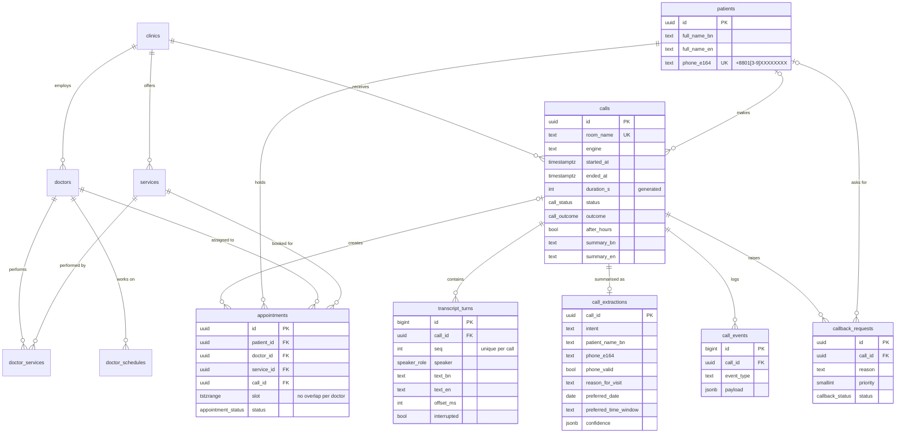

# Data model

**Storage:** Supabase Postgres 17, project `bytevoice-bangla` (`ajxqxqdlgxehhkfokmif`), region **ap-southeast-1 (Singapore)**, the nearest Supabase region to Dhaka.
**Source of truth:** `supabase/migrations/20261104073000_init_schema.sql`. Demo reference data: `supabase/seed.sql`.

## Tables

| Table | One row per | Written by | Why it exists |
|---|---|---|---|
| `clinics`, `doctors`, `services`, `doctor_services`, `doctor_schedules` | Reference data | Seed / admin | The agent quotes fees, hours and doctors **only** from here, so it cannot invent facts |
| `patients` | Person, keyed by phone in E.164 | Agent tools | Repeat callers link to one record; the phone format is enforced by a CHECK constraint |
| `calls` | Call (LiveKit room) | Agent on connect and disconnect | Status, outcome, after-hours flag, bilingual summary; `duration_s` is a generated column |
| `transcript_turns` | Utterance | Agent, live during the call | Speaker-labelled Bangla text, English translation added after the call, offset from call start, interruption flag |
| `call_extractions` | Call | Post-call extraction job | Structured fields kept apart from raw transcripts, so extraction can be re-run without touching the source |
| `appointments` | Booking | `book_appointment` / `reschedule_appointment` tools | `slot` is a `tstzrange`; a GiST **exclusion constraint** makes overlapping active bookings for the same doctor impossible |
| `callback_requests` | Human hand-over | `request_human_callback` tool | Staff queue; staff may update only `status` and `resolved_at` |
| `call_events` | Event | Agent | Tool calls and results, errors, per-turn latency: the audit trail |
| `leads` | Demo request | Landing-page form | The only table anonymous visitors may insert into |
| `call_overview` (view) | Call | — | Portal list view; `security_invoker` so RLS still applies |

## Access control

- Row Level Security is enabled on every table.
- `authenticated` (portal staff) may read everything, and update only callback status.
- `anon` may only insert into `leads`.
- The Python agent writes with the server-side secret key, which bypasses RLS and never reaches the browser.
- Realtime is enabled on `calls`, `transcript_turns` and `call_events`, so the portal shows a call while it is happening.

## Validation

| Field | Rule | Enforced in |
|---|---|---|
| Phone | Bangla digits and spoken digit words normalised → `^01[3-9]\d{8}$` → stored as `+8801…` | Agent `normalize/phone.py` and DB CHECK |
| Appointment slot | Within the doctor's schedule and clinic hours, not in the past, not Friday | Agent `check_availability` and DB exclusion constraint |
| Booking | Requires an explicit caller confirmation (`confirmed=true`) | Agent tool |
| Transcript order | `(call_id, seq)` unique | DB |

## Verified on 4 Nov 2026 (transaction rolled back)

`duration_s` computed (95 s) · overlapping booking for the same doctor **blocked** · overlap with a cancelled booking allowed · 10-digit phone **rejected** · Supabase security advisor: 0 issues.
